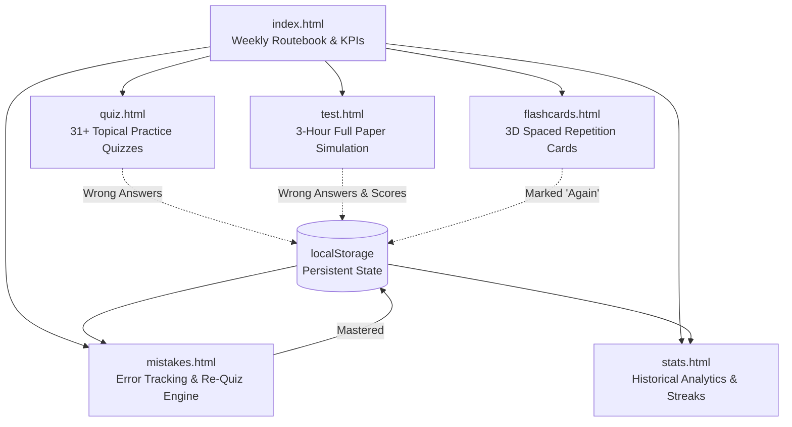

# 🎓 TCS NQT Prep Portal

[](https://supreetvardhamane.github.io/tcs-nqt-prep/)
[](https://github.com/supreetvardhamane/tcs-nqt-prep/actions)
[](LICENSE)
[-orange?style=for-the-badge)](#technical-architecture)
[](#curated-content)

> 🚀 **An enterprise-grade, high-performance static web application engineered for aspirants targeting the Tata Consultancy Services National Qualifier Test (TCS NQT).**  
> Features timed 3-hour exam simulations, 31+ foundation categories, spaced-repetition Anki-style flashcards with C++/Java/Python solutions, automated mistake analytics, and zero-latency client-side execution.

🔗 **Live Website**: [https://supreetvardhamane.github.io/tcs-nqt-prep/](https://supreetvardhamane.github.io/tcs-nqt-prep/)  
📦 **Upstream PYQ Source**: Authenticated Previous Year Questions curated from [TCS-NQT-PYQ-QUESTIONS](https://github.com/Arjunpolen/TCS-NQT-PYQ-QUESTIONS).

---

## 📑 Table of Contents

- [Overview & Philosophy](#-overview--philosophy)
- [Key Features](#-key-features)
  - [1. 3-Hour Timed Exam Simulation](#1--3-hour-timed-exam-simulation-testhtml)
  - [2. Topic-Wise Practice Quiz Engine](#2--topic-wise-practice-quiz-engine-quizhtml)
  - [3. Anki-Style Flashcard & Pattern Review](#3--anki-style-flashcard--pattern-review-flashcardshtml)
  - [4. Persistent Mistakes Notebook & Re-Quiz](#4--persistent-mistakes-notebook--re-quiz-mistakeshtml)
  - [5. Guided Weekly Routebook & Study Planner](#5--guided-weekly-routebook--study-planner)
  - [6. Performance Analytics & Streak Engine](#6--performance-analytics--streak-engine-statshtml)
- [System Architecture](#-system-architecture)
  - [Chunked Base64 Data Pipeline](#chunked-base64-data-pipeline)
  - [Client-Side State & Persistence Layer](#client-side-state--persistence-layer)
- [Repository Structure](#-repository-structure)
- [Keyboard Shortcuts Reference](#-keyboard-shortcuts-reference)
- [Getting Started & Local Development](#-getting-started--local-development)
- [Data Integrity & Validation](#-data-integrity--validation)
- [Continuous Deployment (CI/CD)](#-continuous-deployment-cicd)
- [Contributing](#-contributing)
- [License](#-license)

---

## 💡 Overview & Philosophy

Preparing for competitive campus drives like the **TCS NQT (Foundation + Advanced Cognition + Coding)** requires realistic simulation, active recall, and rigorous revision of past mistakes. Most commercial platforms are bloated with server latency, paywalls, or rigid authentication.

**TCS NQT Prep** is designed with the following engineering principles:
- **Zero Server Latency / Fully Offline-Ready**: 100% client-side execution. Once cached, the entire platform runs seamlessly without network roundtrips.
- **Zero External Runtime Dependencies**: Built strictly with semantic HTML5, modern CSS3 (custom CSS custom properties, grid/flexbox, dark-mode first), and vanilla ECMAScript 2022.
- **Privacy & Persistence**: All diagnostic data, test scores, timer states, and mistake logs are securely managed via client-side `localStorage`. No telemetry, tracking, or account sign-ups required.

---

## ⚡ Key Features



### 1. ⏱️ 3-Hour Timed Exam Simulation (`test.html`)
- **Authentic Test Interface**: Mirrors the real TCS NQT assessment layout with section-by-section breakdown (Numerical Ability, Reasoning Ability, Verbal Ability, Advanced Quant/Reasoning, Advanced Coding).
- **Interactive Question Palette**: Real-time state indicators for:
  - 🟢 Answered
  - 🔴 Not Answered
  - 🟣 Marked for Review
  - 🔵 Marked & Answered
  - ⚪ Not Visited
- **Resilient Timer Engine**: Persistent 3:00:00 countdown timer that seamlessly survives accidental page reloads, browser tab closing, or system sleep.
- **Sectional Analytics**: Immediate performance scoring with accuracy percentages, section-wise breakdown, and automatic timeout submission.

### 2. 🎯 Topic-Wise Practice Quiz Engine (`quiz.html`)
- **31 Topical MCQ Categories**: Over 280+ foundational questions covering Quantitative Aptitude, Logical Reasoning, and Verbal Ability.
- **Instant Explanations**: Immediate answer verification with comprehensive mathematical proofs and logical derivations.
- **Review Mode**: Rapid post-quiz breakdown filtering out correct answers so students can concentrate solely on areas needing improvement.

### 3. 🃏 Anki-Style Flashcard & Pattern Review (`flashcards.html`)
- **3D Interactive Flip Animation**: Accessible via intuitive click or keyboard shortcuts (`Space` to flip).
- **Comprehensive Decks**:
  - **TCS HR Interview Prep** (50 curated HR behavioral questions with model responses).
  - **DSA Easy Patterns** (50 foundational algorithms).
  - **DSA Hard Patterns** (30 advanced dynamic programming, trees, and graph problems).
  - **Verified Coding PYQs** (81+ authenticated TCS coding problems with constraints, test cases, and time/space complexity analysis).
- **Multi-Language Solutions**: Real-time language detection and syntax-styled presentation for **C++**, **Java**, and **Python**.
- **Spaced Repetition Integration**: `Again` [1], `Hard` [2], and `Easy` [3] classification. Marking a card as `Again` automatically injects it into your Mistakes Notebook.

### 4. 📓 Persistent Mistakes Notebook & Re-Quiz (`mistakes.html`)
- **Automated Defect Logging**: Every incorrect attempt across quizzes, full mocks, or flashcards is automatically captured with the question text, user's erroneous response, and the verified correct answer.
- **Categorical Filtering**: Filter errors by category or paper source.
- **Smart Re-Quiz Mode**: Launch a focused quiz consisting *only* of previous mistakes.
- **"Mark as Learned"**: Once a concept is fully understood and solved, remove it from the active mistake ledger into an archival "Learned" state.

### 5. 🗺️ Guided Weekly Routebook & Study Planner
- **Dynamic Weekly Schedule**: Structured preparation cadence (Sunday Review → Mon–Thu Foundations → Friday Revision → Saturday Full Mock).
- **Context-Aware Next Best Action**: Calculates readiness phase (`Baseline`, `Fundamentals`, `Strengthening`, `Mock Prep`, `Final Readiness`) and pinpoints the single most impactful exercise for the student today.

### 6. 📊 Performance Analytics & Streak Engine (`stats.html`)
- **Key Performance Indicators (KPIs)**: Total questions attempted, global accuracy percentage, completed mock tests, and daily study streak counter.
- **Mastery Progress Bars**: Dynamic color-coded bars (Green: $\ge 75\%$, Amber: $50-74\%$, Red: $<50\%$) visualising subject strengths and weaknesses.
- **Attempt History Log**: Audit trail of every completed mock exam with timestamps, duration, and scorecards.

---

## 🛠️ System Architecture

### Chunked Base64 Data Pipeline
To ensure instant initial load times on static CDNs like GitHub Pages while preventing JavaScript parse locks from multi-megabyte payloads, the question bank is encoded and distributed across partitioned modules:

```text
js/qb01.js ───┐
js/qb02.js ───┤
    ...       ├──> window.__TCS_BANK_PARTS[] ──> question-bank.js ──> window.QUESTION_BANK
js/qb22.js ───┘                                (Base64 decode + JSON)     (Ready Event)
```

1. **Partitioning**: The full corpus of 1,150+ questions and flashcards is chunked into 22 lean script files (`js/qb01.js` to `js/qb22.js`).
2. **Asynchronous Assembly**: Each chunk appends its slice to `window.__TCS_BANK_PARTS`.
3. **Decryption & Hydration**: `question-bank.js` concatenates the payload, performs binary base64 decoding via `atob()`, decodes UTF-8 bytes using `TextDecoder`, and dispatches a unified `question-bank-ready` lifecycle event.

### Client-Side State & Persistence Layer
All application state is managed cleanly through `js/storage.js`:

| Key | Type | Description |
|---|---|---|
| `mistakes` | `Array<Mistake>` | Unresolved mistake objects `{questionId, questionText, yourAnswer, correctAnswer, category, section, date}` |
| `learned` | `Array<Mistake>` | Successfully remediated mistakes marked as learned |
| `studyPlan` | `Object` | Active study goals `{dailyTime, target, createdAt, completedActivities}` |
| `testHistory` | `Array<TestResult>`| Completed test logs `{paperId, paperName, score, total, percentage, timeTaken, date}` |
| `progress` | `Object` | Cumulative category stats keyed by category ID `{attempted, correct}` |
| `timerStates` | `Object` | Live remaining countdown seconds per mock paper |
| `streak` | `Object` | Continuous activity tracker `{count, lastDate}` |

---

## 📂 Repository Structure

```text
tcs-nqt-prep/
├── .github/
│   └── workflows/
│       └── deploy.yml          # GitHub Actions workflow for zero-downtime GitHub Pages deploy
├── css/
│   └── style.css               # Unified responsive design system (dark mode, layout grids, components)
├── data/
│   ├── questions.js            # Raw question master dataset for data validation
│   └── question-bank.js        # Formatted canonical question bank
├── js/
│   ├── storage.js              # LocalStorage state management & streak persistence module
│   ├── quiz.js                 # MCQ engine with keyboard shortcuts and review mode
│   ├── test.js                 # 3-Hour full mock examination simulator & question palette engine
│   ├── flashcards.js           # 3D flashcard carousel, syntax labeling, and spaced repetition engine
│   └── qb01.js ... qb22.js     # Chunked base64 question bank payload (parts 1 to 22)
├── flashcards.html             # Anki flashcard study portal
├── index.html                  # Main dashboard, weekly routebook, and KPI summary
├── mistakes.html               # Persistent mistakes notebook and interactive re-quiz mode
├── quiz.html                   # Topic-wise practice quiz interface
├── stats.html                  # Comprehensive analytics, topic mastery charts, and test history
├── test.html                   # 3-Hour timed mock exam portal
├── question-bank.js            # Runtime chunk stitcher, base64 decoder, and event emitter
├── validate-data.js            # CLI schema validation script for CI/CD checks
├── .gitignore                  # Git ignore rules
└── README.md                   # Project documentation
```

---

## ⌨️ Keyboard Shortcuts Reference

Work at maximum speed using built-in keyboard controls:

| Context | Key / Combo | Action |
|---|---|---|
| **Flashcards** | `Space` | Flip card front / back |
| **Flashcards** | `1` | Rate **Again** (needs review; auto-logs to Mistakes) |
| **Flashcards** | `2` | Rate **Hard** |
| **Flashcards** | `3` | Rate **Easy** (marks as mastered) |
| **Practice Quiz** | `A`, `B`, `C`, `D` or `1`–`4` | Select corresponding option |
| **Practice Quiz** | `Enter` | Submit current question |
| **Practice Quiz** | `→` / `Enter` (post-submit) | Advance to next question |
| **Mock Exam** | `N` / `P` | Next / Previous question |

---

## 🚀 Getting Started & Local Development

No complex toolchains, package managers, or compilers are required. You can run the application directly in any modern browser.

### Option 1: Direct File Access
Simply double-click or launch `index.html`:
```bash
# Linux
xdg-open index.html

# macOS
open index.html

# Windows
start index.html
```

### Option 2: Local HTTP Server (Recommended)
Running through an HTTP server ensures full compatibility with browser storage policies and local assets:

```bash
# Using Python 3
python3 -m http.server 8080

# Using Node.js (npx)
npx serve .

# Using PHP
php -S localhost:8080
```
Then navigate to: **`http://localhost:8080`**

---

## 🧪 Data Integrity & Validation

The repository includes an automated validation suite to ensure that questions, IDs, options, and flashcard solutions maintain structural integrity:

```bash
node validate-data.js
```

### Validation Checks:
- ✅ **Uniqueness**: Guarantees no duplicate question or paper IDs exist across the dataset.
- ✅ **Options Consistency**: Validates that all MCQs possess non-empty, non-duplicate choices with valid zero-based correct indices.
- ✅ **Code & Solutions**: Verifies syntax structure of C++ programming solutions and labels source code formats appropriately.

---

## 🚢 Continuous Deployment (CI/CD)

Deployments to GitHub Pages are completely automated via GitHub Actions ([`.github/workflows/deploy.yml`](.github/workflows/deploy.yml)).

Whenever changes are merged into the `main` branch:
1. GitHub Actions triggers the deployment pipeline.
2. The static workspace is configured, packaged, and verified.
3. The site is published live to the global GitHub Pages CDN within seconds.

---

## 🤝 Contributing

Contributions are welcomed! Whether it is adding new TCS NQT past questions, refining problem explanations, or optimizing code solutions:

1. **Fork the Repository**
2. **Create a Feature Branch**:
   ```bash
   git checkout -b feature/new-pyq-batch
   ```
3. **Validate Data**:
   Ensure all question additions pass the validator:
   ```bash
   node validate-data.js
   ```
4. **Commit Your Changes**:
   ```bash
   git commit -m "feat: add 2024 TCS NQT slot-2 reasoning questions"
   ```
5. **Push and Open a Pull Request**

---

## 📄 License

This project is licensed under the **MIT License** — feel free to use, modify, and distribute for personal and educational preparation.

---

<div align="center">
  <sub>Engineered with ❤️ for students preparing for TCS NQT • Maintained by <a href="https://github.com/supreetvardhamane">Supreet Vardhamane</a></sub>
</div>
